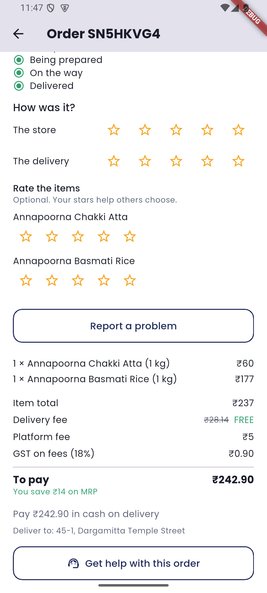
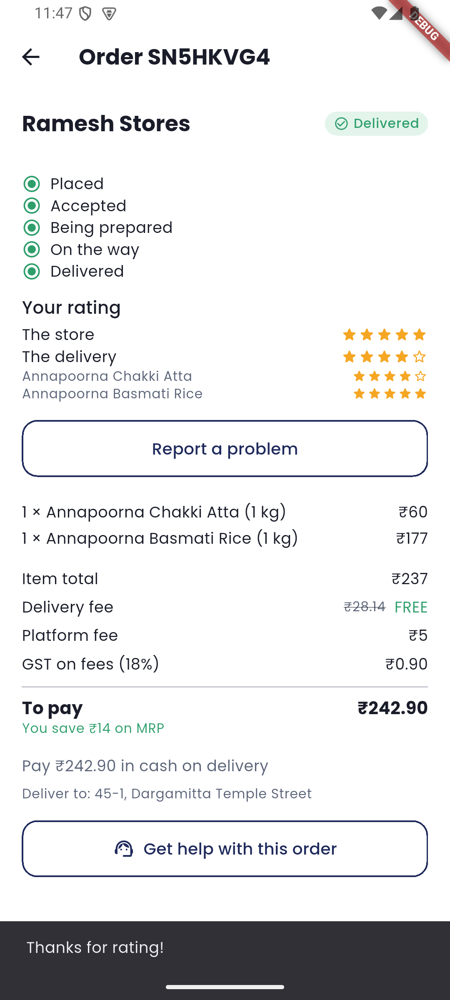
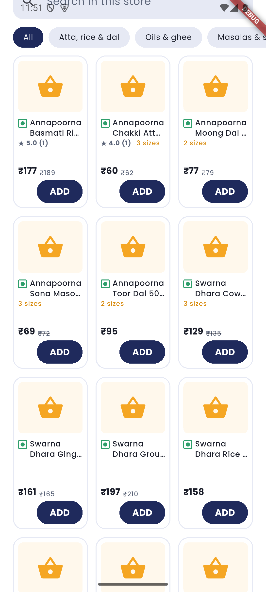

# Item ratings: what was tested (20 November 2026)

Feature: after delivery the customer rates the store, the delivery and, optionally, each item they received (1 to 5
stars). The store page shows each item's average and count. Design: [ADR-045](../decisions/ADR-045-item-ratings.md).

## How it was tested
| Layer | What | Where |
|---|---|---|
| Backend, fake mode (7 scenarios) | item stars saved with the order rating and read back; the store page shows each item's average and count; a second customer moves the average; unrated items stay null; stars are optional; an item that is not on the order, the same item twice, 0 or 6 stars are refused and nothing is saved; a second rating of the same order is refused and changes nothing; another customer cannot read or write the item stars | `apps/backend/test/fake/item-ratings.fake.spec.ts` |
| API model tests | `OrderRating.itemStars`, order line item ids, `StoreItem.rating` (including the offline cache round trip) | `packages/santha_api/test` |
| Consumer app widget tests | rate the store and two items, clear one star by tapping it again, send: only rated items are sent and shown afterwards; rating with no items still works; the store page shows `★ 4.5 (12)` on a rated item and nothing on an unrated one; the item sheet shows the stars | `apps/consumer/test/checkout_test.dart`, `discovery_test.dart` |
| Live e2e journey | an item not on the order is refused (400); the item star is saved, read back and shown on the store page | `apps/web/e2e/journeys/order-to-rating.spec.ts` |
| Emulator, local backend | the real flow below | screenshots |

## Emulator walkthrough (Android 35 emulator, `dev` flavor against the local fake backend)
| Step | Result | Screenshot |
|---|---|---|
| Open a delivered order: below the store and delivery stars is **Rate the items** with each item and five stars | pass |  |
| Rate the store 5, delivery 4, atta 4, rice 5 and send | "Thanks for rating!"; **Your rating** lists the store, delivery and both items with their stars |  |
| Open the store: the items now show **★ 5.0 (1)** and **★ 4.0 (1)**; the store card shows ★ 5.0 | pass |  |

## Found while testing
- A tile with both a rating and a "3 sizes" badge overflowed by about 2 px on the emulator. The rating and the badge now share
  one line and the grid row is 14 px taller. Fixed in the same pull request.

## Not covered
- The Telugu strings for item stars (`rateItemsTitle`, `rateItemsNote`, `rateItemStars`) need a native-speaker check.
- QA runs the old backend until this is merged and deployed, so the live e2e step runs after the deploy.
